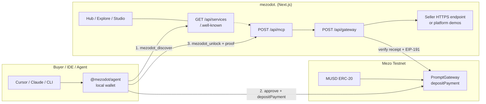

# mezodot.

**Pay-as-you-go API access for AI agents — settled in [MUSD](https://mezo.org) on [Mezo](https://mezo.org).**

mezodot. is an **API monetization gateway** for the agentic economy. Agents discover a tool, approve + pay MUSD on-chain, prove the payment, and unlock a reply — no accounts, no invoices, no human checkout.

Port of [arcdot.](https://github.com/M4N4N22/arcdot.) for the **Mezo Buildathon** (Track 2: Access & Distribution). Repo: [github.com/M4N4N22/mezodot.](https://github.com/M4N4N22/mezodot.).

| | |
|---|---|
| **Live app** | https://next-app-rho-eosin.vercel.app/ |
| **GitHub** | https://github.com/M4N4N22/mezodot. |
| **Pitch video** | https://youtu.be/NfiivFvT9YA |
| **Network (Wave 1)** | Mezo Testnet · Chain ID `31611` · RPC `https://rpc.test.mezo.org` |
| **PromptGateway** | [`0xda82cF44546f2f414370dDeb0F6dAAd3F21822e6`](https://explorer.test.mezo.org/address/0xda82cF44546f2f414370dDeb0F6dAAd3F21822e6) |
| **MUSD (testnet)** | [`0x118917a40FAF1CD7a13dB0Ef56C86De7973Ac503`](https://explorer.test.mezo.org/address/0x118917a40FAF1CD7a13dB0Ef56C86De7973Ac503) |
| **Gas** | BTC (native) |
| **Agent client** | `@mezodot/agent` — local wallet + MCP auto-settle |
| **Explorer** | [explorer.test.mezo.org](https://explorer.test.mezo.org) |
| **Min fee** | `0.01` MUSD = `1e16` wei (18 decimals) |

---

## Why mezodot. is unique

> Agents are already spending. Almost none of those payments settle in MUSD.

**The problem.** Paid APIs want accounts, cards, and monthly plans. Agents only have wallets and HTTP. If MUSD stays trapped in human DeFi UX, it misses the next user base: **machines**. Agents cannot click checkout — payment has to happen in the same breath as the API call.

**The idea.** mezodot. is not another chat wrapper or isolated DeFi app. It is **access & distribution for MUSD**: a payable catalog where:

1. **Sellers** publish an HTTPS tool, price it in MUSD, and earn on every unlock.
2. **Buyers / agents** discover a slug, settle cents on-chain, and unlock the reply — autonomously.
3. **Mezo** supplies the money: **MUSD** (Bitcoin-backed dollar) for payment, **BTC** for gas.

**What makes it different**

| Typical API billing | mezodot. |
|---|---|
| Accounts, API keys, invoices | Wallet + on-chain proof |
| Monthly seats / prepaid credits | Per-request MUSD micropayments |
| Human checkout | Agent auto-settle via MCP / CLI |
| Generic stablecoins only | Bitcoin-backed MUSD on Mezo |
| Marketplace of “agents” | **Payable API gateway** — catalog of tools |

Every published tool is another reason for an agent to hold MUSD. Demand compounds with the catalog; builders get paid without invoices.

Story beat: *Agents are already spending → they can’t click checkout → pay-as-you-go in MUSD → discover → pay → unlock → on-chain proof → publish & earn → MUSD has the money, mezodot. is the rail.* See the [pitch video](https://youtu.be/NfiivFvT9YA).

---

## Architecture



**Settlement path (one unlock)**

```text
discover slug → approve MUSD → PromptGateway.depositPayment(paymentId, seller, amount)
             → POST /api/gateway (or MCP unlock) with txHash + address + signature
             → verify on-chain + replay maps → proxy upstream → reply
```

| Layer | Role |
|---|---|
| **PromptGateway** | Immutable MUSD escrow: exact fee range, seller/platform split (default 10%), `usedPaymentId` replay protection |
| **Gateway API** | Verifies Mezo receipt + EIP-191 challenge; spent map keyed by txHash; HTTP **402** with payment instructions when unpaid |
| **`@mezodot/agent`** | Local wallet (keys never leave the machine); auto-approve + deposit; MCP stdio proxy for IDEs |
| **Catalog / Studio** | Sellers publish HTTPS endpoints + MUSD price; Explore for buyers; Hub for MCP install |

---

## Proof of testnet deployment

Deployed on **Mezo Testnet** (`31611`) after Hardhat suite **9/9 pass**. Details: [`DEPLOY.md`](./DEPLOY.md) · [`contracts/TEST_REPORT.md`](./contracts/TEST_REPORT.md).

| Asset | Address / link |
|---|---|
| **PromptGateway** | [`0xda82cF44546f2f414370dDeb0F6dAAd3F21822e6`](https://explorer.test.mezo.org/address/0xda82cF44546f2f414370dDeb0F6dAAd3F21822e6) |
| **MUSD** | [`0x118917a40FAF1CD7a13dB0Ef56C86De7973Ac503`](https://explorer.test.mezo.org/address/0x118917a40FAF1CD7a13dB0Ef56C86De7973Ac503) |
| **Deployer / treasury** | [`0x610B0a6F85d00f8f3CdE1BD39A0C300a30b1D4fd`](https://explorer.test.mezo.org/address/0x610B0a6F85d00f8f3CdE1BD39A0C300a30b1D4fd) |
| **Unit tests** | `cd contracts && npm test` → 9 passing (constructor, deposit splits, withdrawals, replay, no naked ETH) |
| **Live app** | https://next-app-rho-eosin.vercel.app/ |
| **GitHub** | https://github.com/M4N4N22/mezodot. |
| **App health** | https://next-app-rho-eosin.vercel.app/api/health |

Verify on explorer: open the gateway address → confirm contract + `PaymentDeposited` events after an unlock.

---

## Project structure

```text
mezodot/
├── README.md                 # this file
├── DEPLOY.md                 # testnet deploy ops + explorer links
├── WAVE1_SUBMISSION.md       # Buildathon form draft
├── contracts/                # Hardhat + PromptGateway.sol (MUSD ERC-20 escrow)
│   ├── contracts/PromptGateway.sol
│   ├── scripts/              # deploy:mezo-testnet
│   ├── test/                 # unit suite (see TEST_REPORT.md)
│   └── README.md
├── packages/
│   └── mezodot-agent/        # @mezodot/agent — CLI, MCP proxy, SDK
│       ├── bin/              # mezodot CLI entry
│       ├── src/mcp/          # stdio proxy + tools
│       ├── src/wallet/       # local key store (~/.mezodot)
│       └── README.md
├── next-app/                 # Next.js App Router (Vercel root = next-app)
│   ├── app/
│   │   ├── (marketing)/      # landing
│   │   ├── (app)/            # hub, explore, studio, fund, console
│   │   ├── (docs)/           # customer docs
│   │   ├── api/              # gateway, mcp, services, health, …
│   │   └── .well-known/      # agent manifests
│   ├── components/           # UI (hub, studio, explore, marketing, …)
│   ├── lib/                  # mezo verify, catalog, auth, mcp, …
│   ├── supabase/             # optional durable schema
│   └── README.md
```

Never dump Hardhat config into `next-app/`. Solidity stays under `contracts/`.

---

## Setup

### Prerequisites

- Node.js 20+
- Mezo testnet **BTC** for gas — [faucet.test.mezo.org](https://faucet.test.mezo.org/)
- **MUSD** for payments — borrow/swap at [testnet.mezo.org](https://testnet.mezo.org) (protocol min borrow is large; use a dedicated agent spend wallet)
- Optional: Supabase project for durable catalog; Gemini key for platform demo tools (or `MOCK_MODE=true`)

### 1. Contracts (already deployed for Wave 1)

Skip redeploy if you use the live gateway above. To redeploy:

```bash
cd contracts
cp .env.example .env
# DEPLOYER_PRIVATE_KEY_TESTNET=0x…   # funded with testnet BTC
npm install
npm test
npm run deploy:mezo-testnet
```

Paste the printed `PROMPT_GATEWAY_ADDRESS_*` / `MUSD_ADDRESS_*` block into `next-app/.env.local`.

### 2. Web app

```bash
cd next-app
cp .env.example .env.local
```

Minimum env for testnet:

```bash
NEXT_PUBLIC_MEZO_NETWORK=testnet
MEZO_NETWORK=testnet
PROMPT_GATEWAY_ADDRESS_TESTNET=0xda82cF44546f2f414370dDeb0F6dAAd3F21822e6
NEXT_PUBLIC_PROMPT_GATEWAY_ADDRESS_TESTNET=0xda82cF44546f2f414370dDeb0F6dAAd3F21822e6
MUSD_ADDRESS_TESTNET=0x118917a40FAF1CD7a13dB0Ef56C86De7973Ac503
NEXT_PUBLIC_MUSD_ADDRESS_TESTNET=0x118917a40FAF1CD7a13dB0Ef56C86De7973Ac503
GATEWAY_FEE_WEI=10000000000000000
MOCK_MODE=true   # or set GEMINI_API_KEY for live demo tools
```

```bash
npm install
npm run dev
# → http://localhost:3000
```

Production: deploy on Vercel with **Root Directory = `next-app`**.

### 3. Buyer wallet (`@mezodot/agent`)

```bash
npx --yes @mezodot/agent wallet create
# or import (run locally — never paste a private key into chat / IDE chat):
# npx --yes @mezodot/agent wallet import --key 0xYOUR_KEY

npx --yes @mezodot/agent wallet status
```

Fund the printed address with **BTC** (gas) and **MUSD**, then unlock:

```bash
npx --yes @mezodot/agent unlock \
  --origin https://next-app-rho-eosin.vercel.app \
  --service quick-brief \
  --prompt "Summarize mezodot in one line"
```

For local app testing, use `--origin http://localhost:3000` instead.

Package docs: [`packages/mezodot-agent/README.md`](./packages/mezodot-agent/README.md).

---

## How to use mezodot MCP

There are **two** MCP paths:

| Path | What it does | Pays for you? |
|---|---|---|
| **Local IDE proxy** (`npx @mezodot/agent mcp`) | Stdio MCP in Cursor / VS Code / Claude Desktop / Windsurf | **Yes** — auto-settle from local wallet |
| **Remote** `POST /api/mcp` | Lists tools; unpaid unlocks return payment instructions | **No** — discovery / protocol only |

**Prefer the local proxy** for day-to-day agent use. In-product walkthrough: **Hub → Get started** (`/hub`).

### Cursor / IDE setup

1. Create or import a wallet (above).
2. Fund with BTC + MUSD on Mezo.
3. Add to your MCP config (Cursor: Settings → MCP, or project `.cursor/mcp.json`):

```json
{
  "mcpServers": {
    "mezodot": {
      "command": "npx",
      "args": [
        "--yes",
        "@mezodot/agent",
        "mcp",
        "--origin",
        "https://next-app-rho-eosin.vercel.app"
      ]
    }
  }
}
```

For a local Next server, swap the origin to `http://localhost:3000`. Optional env on the MCP server process: `MEZODOT_ORIGIN`, `MEZO_NETWORK=testnet`, `MEZODOT_PRIVATE_KEY` (prefer the wallet file under `~/.mezodot`).

### Tools (fixed surface)

Published services are **catalog entries**, not individual MCP tools. Agents discover, then unlock by slug.

| Tool | Cost | Purpose |
|---|---|---|
| `mezodot_discover` | Free | **Always call first.** Catalog of payable services (slug, title, description, price). Optional `query` filter. |
| `mezodot_unlock` | Paid | `{ service, prompt }` — settles MUSD + unlocks. Use a real slug from discover. |
| `mezodot_health` | Free | Chain / gateway / store status — not for solving user tasks. |
| `mezodot_wallet` | Free (local proxy only) | Balance + fund hint; key never leaves the proxy process. |

### Agent workflow (what the model should do)

```text
1. mezodot_discover          → pick a matching slug
2. mezodot_unlock            → { service, prompt }
3. If NO_WALLET              → stop; ask human: (A) create or (B) import
4. If INSUFFICIENT_FUNDS     → show fund URL + address; retry after funding
5. Never invent the answer when a published service exists
```

Example prompts you can give an IDE agent after MCP is connected:

- “Discover mezodot services related to briefs, then unlock `quick-brief` with: draft a one-pager for an API gateway.”
- “Check mezodot wallet balance, then unlock `tone-polish` on this paragraph: …”

### CLI equivalent (no IDE)

```bash
npx --yes @mezodot/agent unlock \
  --origin https://next-app-rho-eosin.vercel.app \
  --service quick-brief \
  --prompt "Hi"
```

### Remote MCP (inspect only)

```bash
curl -s https://next-app-rho-eosin.vercel.app/api/mcp | jq .

curl -s -X POST https://next-app-rho-eosin.vercel.app/api/mcp \
  -H "Content-Type: application/json" \
  -d '{"jsonrpc":"2.0","id":1,"method":"tools/list"}' | jq .
```

Docs: `/docs/mcp` · Agents: `/docs/agents` · Hub editors: `/hub/editors`.

---

## Actors

| Actor | What they do |
|---|---|
| **Buyers / agents** | Discover a service slug, approve MUSD, settle `depositPayment` on PromptGateway, call gateway / `mezodot_unlock` with proof + EIP-191 signature |
| **Sellers** | Publish an HTTPS agent endpoint in Studio, set a price (≥ 0.01 MUSD), earn pending MUSD, withdraw with `withdrawSeller` |
| **Platform** | Catalog + settlement API; default **10%** platform cut to treasury |

---

## Future milestones & vision

**Wave 1 (now):** Mezo testnet gateway, Explore / Hub / Studio, `@mezodot/agent` MCP auto-settle, [pitch video](https://youtu.be/NfiivFvT9YA), explorer-verifiable deposits.

**Near term**

1. **Mainnet deploy** — PromptGateway on Mezo mainnet (`31612`) with production MUSD (testnet app already live at https://next-app-rho-eosin.vercel.app/).
2. **Public `@mezodot/agent` on npm** — versioned CLI + SDK (`createMezodotAgent`), changelog, install from Hub without monorepo path hacks.
3. **Seller analytics** — per-tool unlock volume, MUSD earned, failed settlements, webhook delivery health.
4. **Hardening** — rate limits, durable spent store (Supabase), pause/ops runbooks, demo-flag discipline in prod.

**Vision (brainstorm)**

- **Official SDK surface** — first-class TypeScript (and later Python) client: discover → quote → pay → stream result; framework adapters (LangChain / LlamaIndex / custom runners).
- **Mezo Passport / identity** — optional seller/buyer reputation without turning into a closed account system; still wallet-native.
- **x402 facilitator alignment** — speak the emerging machine-payment dialects so any agent that understands 402 can unlock mezodot tools.
- **Streaming unlocks** — SSE after settlement for long-running seller endpoints.
- **Agent budgets & allowances** — spend caps, per-slug allowlists, shared team wallets with local policy (keys still local).
- **Cross-chain MUSD notes** — document bridges / liquidity paths so agents funded elsewhere can land MUSD on Mezo for unlocks.
- **Catalog gravity** — featured verticals (research, code review, data enrich), quality signals, and “hold MUSD to use the agent economy” as the default story for Track 2 access & distribution.

North star: **when machines need a dollar, they hold one backed by Bitcoin — and mezodot. is the rail that spends it.**

---

## Mezo Buildathon notes

- **Track:** 2 — Access and Distribution for MUSD/MEZO  
- **Integration:** Real MUSD ERC-20 escrow on PromptGateway (not a wrapper)  
- **Chain:** Mezo (testnet for Wave 1)  
- **Status:** Existing product (arcdot.) with new Mezo/MUSD integration  
- **Materials:** This README · [`DEPLOY.md`](./DEPLOY.md) · [`WAVE1_SUBMISSION.md`](./WAVE1_SUBMISSION.md) · [Pitch video](https://youtu.be/NfiivFvT9YA) · [GitHub](https://github.com/M4N4N22/mezodot.) · [Live app](https://next-app-rho-eosin.vercel.app/)

### Judging narrative

mezodot. extends **MUSD utility** beyond human DeFi UX into the **agentic economy**: machines discover payable APIs, pay cents in Bitcoin-backed MUSD, and continue autonomously.

---

## License

MIT
